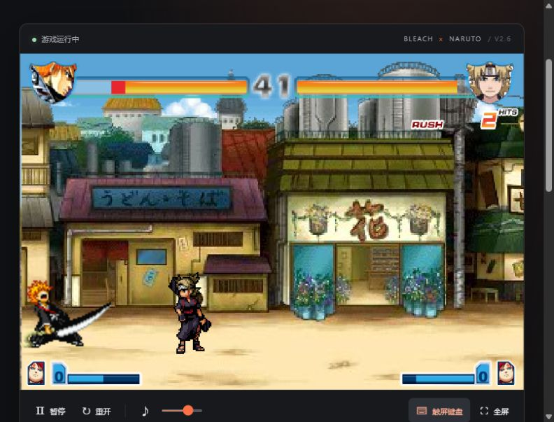

# 死神 VS 火影 2.6 · 浏览器兼容版

保留原版 2.6 的游戏内容，使用 **HTML / CSS / JavaScript + Ruffle 0.7.1 (WebAssembly)** 在现代浏览器里运行，无需 Flash 插件。

这是原版 SWF 的浏览器兼容移植，不是将 ActionScript 全部重写成 JavaScript。

## 实机画面



## 启动

Windows 安装 Node.js 18 或以上后，双击 `启动游戏.bat`，浏览器会打开游戏。

也可以在本目录运行：

```sh
npm start
```

打开 http://127.0.0.1:4091 。**不需要 npm install**。本地资源已包含在项目内，启动后不需要从原游戏站下载角色。

不要直接双击 `dist/index.html`；浏览器对 file:// 页面加载 WASM 和游戏资源有限制。若端口被占用，可先结束之前的服务，或通过环境变量 `BVN_PORT` 改用其他端口。

## 操作

点击“开始游戏”，原版片头后用键盘操作菜单。W / S 选择，J 确认，K 返回。先选模式、角色和援助，再开始对战；不同模式可能还需要选择地图。

| 动作 | 玩家一 | 玩家二 |
| --- | --- | --- |
| 移动 / 菜单选择 | W A S D | 方向键 |
| 攻击 / 确认 | J | 数字小键盘 1 |
| 跳跃 / 返回 | K | 数字小键盘 2 |
| 冲刺 | L | 数字小键盘 3 |
| 远攻 | U | 数字小键盘 4 |
| 必杀 | I | 数字小键盘 5 |
| 援助 | O | 数字小键盘 6 |
| 防御 | S | ↓ |

玩家二请开启 Num Lock。触屏键盘支持切换 1P / 2P、多指方向与攻击组合；手机横屏更舒适。桌面也可点击触屏按键。

新增网页功能：

- 保持原版 600 × 400 的画面比例，响应式布局与全屏。
- 暂停、继续、重开确认、音量与静音；音量设置保存在本机浏览器。
- 页面失去焦点或进入后台时自动暂停，回到页面后手动继续。
- 多指触屏按键、短按保留最小按住时间、取消触摸时释放按键。
- 原版角色、援助与音乐资源随项目提供。
- 加载进度、错误提示及重试。

## 文件

- `dist/`：可部署的静态站点（完整游戏和运行库）。
- `dist/app.js`：播放器生命周期、键位、触屏控制和设置。
- `dist/style.css`：页面设计与响应式布局。
- `dist/game/main.swf`：从原发布文件中提取的原始游戏载荷，未改写游戏脚本。
- `dist/game/fighter/`：角色与援助。
- `dist/game/music/`：背景音乐。
- `dist/vendor/ruffle/`：固定版本 0.7.1 的官方浏览器发行包与许可证。
- `sources/original-wrapper.swf`：原站公开发布的容器文件，留作来源比对。
- `sources/asset-manifest.json`：来源、字节长度和 SHA-256 校验值。
- `server.cjs`：仅监听本机回环地址的零依赖静态服务器。

原容器中的 DefineBinaryData（ID 3）就是游戏本体。将这个原样载荷作为主游戏，可避免依赖旧站的账号/广告加载服务；游戏自身内容、片头和署名没有重写。原站账号、积分、排行榜和付费服务不属于这个移植版本。

## 部署

将 `dist` 目录完整部署到静态 Web 服务器即可。服务器须以 `application/wasm` 提供 `.wasm`，以 `application/x-shockwave-flash` 提供 `.swf`。不要更改角色文件名大小写。无需数据库或服务端账号。

Ruffle 在运行时按需加载 WASM，游戏会按所选角色加载对应资源。兼容引擎与原生 Flash 可能有细节差异；未逐一验证每位角色的所有连招、变身和特殊模式。手机性能影响实际帧率。

## 验证

```sh
npm test
```

检查 75 个游戏文件的 SHA-256、文件完整性、SWF 解压长度、JavaScript 语法及 Ruffle 版本与 WASM 文件签名。

## 来源与许可

- 原游戏：[4399 死神 VS 火影 2.6](https://www.4399.com/flash/176245.htm)。游戏画面、角色、音乐与原始 SWF 的权利归相应权利人，本项目不宣称拥有这些资产。
- 兼容引擎：[Ruffle](https://ruffle.rs/)，MIT / Apache-2.0；原许可证保留在 `dist/vendor/ruffle/`。
- 新增网页外壳与本地服务器代码可自行修改；这不授予原游戏或动漫素材的额外许可。

